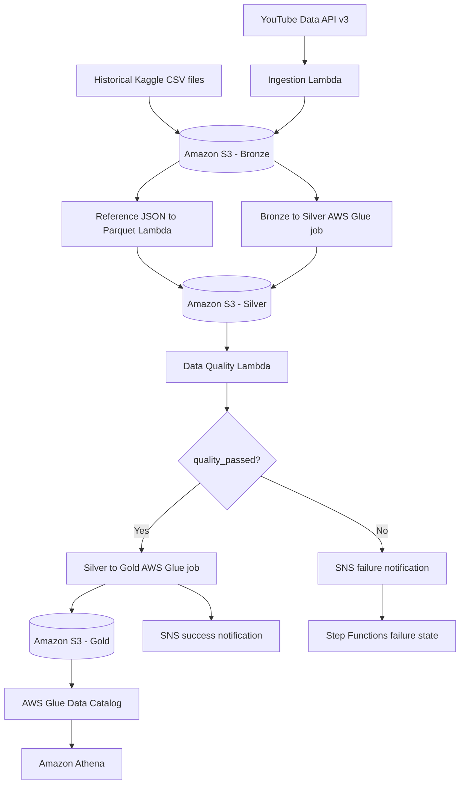

# YouTube Trending Data Engineering Pipeline on AWS

An end-to-end data engineering project that collects YouTube trending-video data, stores raw and curated datasets in Amazon S3, transforms the data with AWS Glue and Lambda, validates the Silver layer, and publishes analytics-ready Gold tables for querying with Amazon Athena.

The implementation uses a **Bronze → Silver → Gold** medallion layout. AWS Step Functions coordinates the pipeline, including parallel Silver transformations and a data-quality gate before Gold aggregation.

## Architecture


## What the pipeline does

- Fetches trending videos and category reference data from the YouTube Data API v3 for **CA, GB, IN, and US**.
- Keeps historical Kaggle CSV data and live API snapshots in separate Bronze prefixes.
- Converts raw statistics and category reference data into curated Parquet datasets in Silver.
- Runs automated data-quality checks against both Silver tables.
- Stops the normal processing path when the quality gate does not pass.
- Builds three analytics datasets in Gold: trending, channel, and category analytics.
- Registers the datasets in the AWS Glue Data Catalog so they can be queried from Athena.
- Uses SNS for pipeline success and failure notifications.

## Architecture



### Orchestration sequence

The Standard Step Functions state machine `yt-data-pipeline-orchestrator-dev` runs the following sequence:

1. **IngestFromYouTubeAPI** – invokes the ingestion Lambda. The Lambda returns the S3 keys of the live category-reference JSON files as well as the ingestion result.
2. **ProcessInParallel** – starts two branches:
   - **TransformReferenceData** – a Map state invokes the reference-data Lambda once for each returned reference JSON key (four invocations for the four configured regions).
   - **TransformStatistics** – runs the Bronze-to-Silver Glue job synchronously.
3. **RunDataQualityChecks** – invokes the DQ Lambda for `clean_statistics` and `clean_reference_data`.
4. **CheckDataQuality** – continues to Gold only when `quality_passed` is `true`; otherwise routes to failure notification.
5. **TransformSilverToGold** – runs the Gold Glue job synchronously.
6. **NotifySuccess** – publishes the success message to SNS. Errors caught by the workflow route to **NotifyFailure**, followed by **PipelineFailed**.

The Step Functions definition includes retries for selected Lambda service/throttling errors and Catch paths for the main task/parallel failures. The pipeline has been run manually and successfully. An EventBridge schedule is **not documented as deployed** in this version.

## AWS services and tools

| Area | Service / technology | Purpose |
|---|---|---|
| Source | YouTube Data API v3 | Live trending-video and category-reference data |
| Historical input | Kaggle YouTube trending CSV dataset | Historical/backfill data |
| Object storage | Amazon S3 | Bronze, Silver, Gold, and script storage |
| Serverless processing | AWS Lambda (Python) | API ingestion, reference conversion, data-quality checks |
| Distributed processing | AWS Glue 5.0 / PySpark | Statistics cleansing and Gold aggregations |
| Orchestration | AWS Step Functions (Standard) | Workflow, parallel branches, retries, routing |
| Metadata | AWS Glue Data Catalog | Database/table metadata and partitions |
| SQL | Amazon Athena | Validation and analytics queries |
| Notifications | Amazon SNS | Success/failure notifications |
| Monitoring | Amazon CloudWatch | Lambda, Glue, and Step Functions logs |
| Access control | AWS IAM | Service execution roles and resource permissions |

## AWS environment and resources

**Region:** `ap-south-1` (Mumbai)

### S3 buckets

| Layer / purpose | Bucket |
|---|---|
| Bronze | `yt-data-pipeline-brz-ap-south-1-dev` |
| Silver | `yt-data-pipeline-silv-ap-south-1-dev` |
| Gold | `yt-data-pipeline-golde-ap-south-1-dev` |
| Scripts | `yt-data-pipeline-scrpt-ap-south-1-dev` |
| Athena query results | `yt-data-pipeline-glue-athena-queree-results` |

### Glue databases

- Bronze: `yt_pipeline_bronze_dev`
- Silver: `yt_pipeline_silver_dev`
- Gold: `yt_pipeline_gold_dev`

### Lambda functions

| Function | Responsibility |
|---|---|
| `yt-data-pipeline-youtube-ingestion-dev` | Calls YouTube API and writes live JSON data to Bronze |
| `yt-data-pipeline-json-to-parquet-dev` | Converts category-reference JSON objects to Silver Parquet |
| `yt-data-pipeline-data-quality-dev` | Checks Silver schemas, row counts, nulls, value ranges, and freshness |

### Glue jobs

| Job | Responsibility |
|---|---|
| `yt-data-pipeline-bronze-to-silver-dev` | Unifies historical CSV and live API statistics into Silver |
| `yt-silver-to-gold-analytics-dev` | Builds trending, channel, and category analytics in Gold |

Both Glue jobs were configured for **Glue 5.0**. The Gold job uses the `yt-data-pipeline-glue-role-dev` execution role. The Step Functions execution role is `yt-datapipeline-stepfunction-dev`.

### Step Functions and SNS

- State machine: `yt-data-pipeline-orchestrator-dev`
- State machine type: Standard
- SNS topic: `yt-data-pipeline-alerts-dev`

Resource identifiers and account-specific ARNs are intentionally not included in this README. Configure your own ARNs and account-specific values when reproducing the project.

## S3 data layout

### Bronze

```text
yt-data-pipeline-brz-ap-south-1-dev/
└── youtube/
    ├── raw_statistics_csv/
    │   ├── region=ca/
    │   ├── region=gb/
    │   ├── region=in/
    │   └── region=us/
    ├── raw_statistics_api/
    │   └── region=<region>/date=<YYYY-MM-DD>/hour=<HH>/<ingestion_id>.json
    ├── raw_statistics_reference_data_old/
    │   └── region=<region>/<REGION>_category_id.json
    └── raw_statistics_reference_api/
        └── region=<region>/date=<YYYY-MM-DD>/<region>_category_id.json
```

- `raw_statistics_csv/` contains historical CSV input.
- `raw_statistics_api/` contains live trending-video snapshots from the API.
- `raw_statistics_reference_data_old/` contains historical category lookup JSON files.
- `raw_statistics_reference_api/` contains live category lookup JSON files returned by the ingestion Lambda.

### Silver

```text
yt-data-pipeline-silv-ap-south-1-dev/
└── youtube/
    ├── statistics/
    │   ├── region=ca/
    │   ├── region=gb/
    │   ├── region=in/
    │   └── region=us/
    └── reference_data/
        ├── region=ca/
        ├── region=gb/
        ├── region=in/
        └── region=us/
```

The Silver Glue Catalog database is `yt_pipeline_silver_dev`, with these tables:

- `clean_statistics`
- `clean_reference_data`

The reference table includes normalized category fields such as `id`, `snippet_title`, `snippet_assignable`, `snippet_channelid`, plus ingestion/source metadata and the `region` partition.

### Gold

```text
yt-data-pipeline-golde-ap-south-1-dev/
└── youtube/
    ├── trending_analytics/
    │   ├── region=ca/
    │   ├── region=gb/
    │   ├── region=in/
    │   └── region=us/
    ├── channel_analytics/
    │   ├── region=ca/
    │   ├── region=gb/
    │   ├── region=in/
    │   └── region=us/
    └── category_analytics/
        ├── region=ca/
        ├── region=gb/
        ├── region=in/
        └── region=us/
```

All three Gold datasets are stored as Parquet and registered in the `yt_pipeline_gold_dev` Glue database.

## Transformation details

### 1. YouTube API ingestion

The ingestion Lambda uses the YouTube Data API v3 to retrieve trending videos and category metadata for the configured regions (`US,GB,CA,IN`). It writes raw API responses to the Bronze bucket and returns a list of live reference JSON keys. The reference keys are passed from the ingestion result into the Step Functions Map state, avoiding a hard-coded list of reference files in the workflow.

The API key is supplied through the Lambda environment variable `YOUTUBE_API_KEY`. **Never commit the key or any other credentials to source control.**

### 2. Bronze to Silver statistics (Glue / PySpark)

The Glue job reads the Bronze Catalog tables:

- `yt_pipeline_bronze_dev.raw_statistics_csv`
- `yt_pipeline_bronze_dev.raw_statistics_api`

It handles the historical CSV and live API input shapes, flattens the API `items` structure, normalizes dates and types, and combines the sources into a unified statistics dataset. It deduplicates records using video, region, and trending-date keys, preferring the live API record and then the higher snapshot hour when applicable. It also derives an engagement-rate metric.

The output is Snappy-compressed Parquet under `youtube/statistics/`, partitioned by region, and catalogued as `yt_pipeline_silver_dev.clean_statistics`.

The statistics job refreshes the statistics output prefix; it does not write to `youtube/reference_data/`.

### 3. Reference JSON to Silver Parquet (Lambda)

The reference Lambda receives an S3-style event from the Step Functions Map state. For each reference JSON file, it normalizes the category `items`, validates required category fields, deduplicates by category ID, adds ingestion timestamp and source-file metadata, and writes region-partitioned Parquet to `youtube/reference_data/`.

The Glue Catalog table is `yt_pipeline_silver_dev.clean_reference_data`. The live-reference S3 event notification was removed after the Step Functions integration was introduced, preventing the live reference files from being processed both by S3 notification and by the workflow. The historical reference notification remains enabled.

### 4. Silver data-quality gate

The DQ Lambda is invoked with the Silver database and both Silver table names. The checks cover schema, minimum row counts, critical-column null percentages, value/range rules, and freshness where the selected data supports a freshness check.

For the successful validation run documented below, the Lambda returned:

```json
{
  "quality_passed": true,
  "checks_passed": 19,
  "checks_total": 19
}
```

Freshness was intentionally skipped for the statistics table because its `trending_date` represents the historical trending date rather than the ingestion timestamp. Reference-data freshness was checked against the ingestion timestamp.

### 5. Silver to Gold analytics (Glue / PySpark)

The Gold job reads `clean_statistics` and `clean_reference_data`, joins category IDs to category names, and generates three analytics datasets:

| Gold table | Grain / purpose | Examples of metrics |
|---|---|---|
| `trending_analytics` | Daily trending summary per region | Video count, total views/likes/comments, average views, engagement rate, unique channels/categories |
| `channel_analytics` | Channel performance per region | Videos, views, likes, comments, average views, engagement, times trending, first/last trending dates, regional rank |
| `category_analytics` | Category performance per region and trending date | Video count, views, likes, comments, average engagement, unique channels, view share |

The job writes region-partitioned Parquet and updates the Gold Glue Catalog. The deployed version was updated to replace each region's output partition with the recomputed data, rather than blindly accumulating another copy on every run. This is intended to make reruns repeatable for the same Silver input.

## Configuration reference

### Ingestion Lambda environment variables

| Variable | Purpose |
|---|---|
| `YOUTUBE_API_KEY` | YouTube Data API v3 key (secret; do not commit) |
| `S3_BUCKET_BRONZE` | `yt-data-pipeline-brz-ap-south-1-dev` |
| `YOUTUBE_REGIONS` | `US,GB,CA,IN` |
| `SNS_ALERT_TOPIC_ARN` | SNS topic ARN used for failure alerts |

### Reference Lambda environment variables

| Variable | Value |
|---|---|
| `GLUE_DB_SILVER` | `yt_pipeline_silver_dev` |
| `GLUE_TABLE_REFERENCE` | `clean_reference_data` |
| `S3_BUCKET_SILVER` | `yt-data-pipeline-silv-ap-south-1-dev` |
| `SNS_ALERT_TOPIC_ARN` | SNS topic ARN used for failure alerts |

### Glue job arguments

**Bronze to Silver**

| Argument | Value |
|---|---|
| `--bronze_database` | `yt_pipeline_bronze_dev` |
| `--bronze_csv_table` | `raw_statistics_csv` |
| `--bronze_api_table` | `raw_statistics_api` |
| `--silver_bucket` | `yt-data-pipeline-silv-ap-south-1-dev` |
| `--silver_database` | `yt_pipeline_silver_dev` |
| `--silver_table` | `clean_statistics` |

**Silver to Gold**

| Argument | Value |
|---|---|
| `--silver_database` | `yt_pipeline_silver_dev` |
| `--gold_bucket` | `yt-data-pipeline-golde-ap-south-1-dev` |
| `--gold_database` | `yt_pipeline_gold_dev` |

The Gold Glue job also had the job parameter `--conf` set to `spark.eventLog.rolling.enabled=true`.

## Running the pipeline

The workflow has been validated using manual Step Functions executions. To run it from the AWS Console:

1. Open **AWS Step Functions** in `ap-south-1`.
2. Open `yt-data-pipeline-orchestrator-dev`.
3. Choose **Start execution**.
4. Use an empty JSON object as the input:

   ```json
   {}
   ```

5. Start the execution and wait for the execution status to become `SUCCEEDED`.
6. Inspect the state view to confirm the ingestion, four reference Map iterations, statistics transformation, DQ check, Gold transformation, and SNS success state.

A successful execution should follow this high-level path:

```text
IngestFromYouTubeAPI
        |
        v
  ProcessInParallel
    /          \
Reference    Statistics
  Map          Glue
    \          /
        v
RunDataQualityChecks
        |
        v
  CheckDataQuality
        |
        v
TransformSilverToGold
        |
        v
   NotifySuccess
```

## Validation and successful run evidence

The following results were observed during the successful end-to-end run on **14 November 2026**. These are actual validation outputs from the deployed environment, not target or sample values.

### Step Functions execution

The Standard state machine completed with all displayed states marked `Succeeded`, including:

- `IngestFromYouTubeAPI`
- Four `InvokeReferenceLambda` Map iterations
- `TransformReferenceData`
- `TransformStatistics`
- `ProcessInParallel`
- `RunDataQualityChecks`
- `CheckDataQuality`
- `TransformSilverToGold`
- `NotifySuccess`

The observed end-to-end execution duration was approximately **6 minutes**.


### Data quality result

The DQ Lambda returned `quality_passed: true`, with **19 of 19 checks passing**. The validated Silver data included:

| Silver table | Rows observed | Result |
|---|---:|---|
| `clean_statistics` | 200 | Schema, row-count, critical-null and range checks passed |
| `clean_reference_data` | 125 | Schema, row-count, critical-null and freshness checks passed |

The statistics freshness check was skipped by design because the field used for trending date is not an ingestion timestamp.

### Gold table row counts

Athena returned the following row counts after the Gold transformation:

| Gold table | Rows |
|---|---:|
| `trending_analytics` | 4 |
| `channel_analytics` | 200 |
| `category_analytics` | 23 |
| **Total** | **227** |

The `trending_analytics` query returned one row for each configured region:

| Region | Videos | Total views | Total likes | Trending date |
|---|---:|---:|---:|---|
| CA | 50 | 100,599,245 | 1,833,396 | 2026-11-04 |
| GB | 50 | 108,811,162 | 1,584,175 | 2026-11-04 |
| IN | 50 | 155,408,296 | 1,814,284 | 2026-11-04 |
| US | 50 | 46,127,269 | 841,699 | 2026-11-04 |

`total_dislikes` was NULL in the returned records. This field is not used as a pipeline success criterion; public dislike counts are not available through the current YouTube Data API response in the same way as the other engagement metrics.

### Repeat-run check

The pipeline was executed again and the Gold table counts remained unchanged:

| Gold table | First observed run | Repeat run |
|---|---:|---:|
| `trending_analytics` | 4 | 4 |
| `channel_analytics` | 200 | 200 |
| `category_analytics` | 23 | 23 |

This is a useful repeatability check and is consistent with the region-partition replacement strategy. Matching row counts alone do not prove that every field in every row is identical; a record-level comparison or checksum would provide stronger evidence.

### Gold Glue job configuration evidence

The Gold Glue job was configured with Glue 5.0, Python 3, and the expected database and bucket arguments.


### Step Functions configuration evidence

The state machine is configured as a Standard workflow with CloudWatch logging set to `ALL` and the project execution role.


## Athena queries

Select the `yt_pipeline_gold_dev` database in Athena before running these queries.

### Row counts across all Gold tables

```sql
SELECT 'trending_analytics' AS table_name, COUNT(*) AS total_rows
FROM trending_analytics

UNION ALL

SELECT 'channel_analytics', COUNT(*)
FROM channel_analytics

UNION ALL

SELECT 'category_analytics', COUNT(*)
FROM category_analytics;
```

### Trending summary by region

```sql
SELECT
    trending_date,
    region,
    total_videos,
    total_views,
    total_likes,
    total_comments,
    avg_views_per_video,
    avg_engagement_rate,
    unique_channels,
    unique_categories
FROM trending_analytics
ORDER BY region;
```

### Top channels in a region

```sql
SELECT
    channel_title,
    total_videos,
    total_views,
    avg_engagement_rate,
    times_trending,
    rank_in_region
FROM channel_analytics
WHERE region = 'in'
ORDER BY rank_in_region
LIMIT 10;
```

### Category performance

```sql
SELECT
    region,
    category_name,
    trending_date,
    video_count,
    total_views,
    avg_engagement_rate,
    view_share_pct
FROM category_analytics
ORDER BY region, trending_date, total_views DESC;
```

## Repository layout suggestion

The following layout is suitable for keeping the project code and documentation together in GitHub. The names below describe a clean repository organization; include the deployed scripts and state-machine definition in the corresponding folders when preparing the repository.

```text
youtube-data-engineering-pipeline/
├── README.md
├── lambdas/
│   ├── youtube_ingestion/
│   │   └── lambda_function.py
│   ├── json_to_parquet/
│   │   └── lambda_function.py
│   └── data_quality/
│       └── lambda_function.py
├── glue_jobs/
│   ├── bronze_to_silver.py
│   └── silver_to_gold.py
├── step_functions/
│   └── pipeline_orchestrator.asl.json
├── sql/
│   └── gold_validation_queries.sql
├── assets/
│   ├── step-functions-success.png
│   ├── gold-glue-job-parameters.png
│   └── step-functions-configuration.png
└── docs/
    └── data-layout.md
```

Do not commit Lambda deployment ZIPs, credentials, `.env` files, AWS account-specific secrets, or raw API keys. Consider adding a `.gitignore` before pushing the project to GitHub.

## Security and operational notes

- Store the YouTube API key in Lambda environment configuration or a secrets-management service; never put it in source code or README files.
- Use IAM roles with least-privilege S3, Glue, Lambda, SNS, and logging permissions.
- Avoid publishing account IDs, full resource ARNs, access keys, or sensitive execution payloads in public screenshots.
- The live reference-data S3 notification was removed when Step Functions began invoking the reference Lambda directly. Keep this distinction if reproducing the event setup, otherwise the same live reference file may be processed twice.
- Manual Step Functions execution and a successful end-to-end run are verified. EventBridge scheduling and a deliberate failure-path test were not completed as part of the evidence captured for this README.
- SNS `NotifySuccess` completed successfully in the Step Functions execution. The execution view confirms the publish task succeeded; inbox delivery was not separately documented here.

## Reference

- [YouTube Data Pipeline tutorial repository by Darshil Parmar](https://github.com/darshilparmar/youtube-data-piepline-aws-s3-lambda-glue-athena-stepfunction)
- [YouTube Data API v3 documentation](https://developers.google.com/youtube/v3)
- [AWS Step Functions documentation](https://docs.aws.amazon.com/step-functions/)
- [AWS Glue documentation](https://docs.aws.amazon.com/glue/)
- [Amazon Athena documentation](https://docs.aws.amazon.com/athena/)

---

*Project status documented from the deployed AWS environment and execution results observed on 14 November 2026.*
